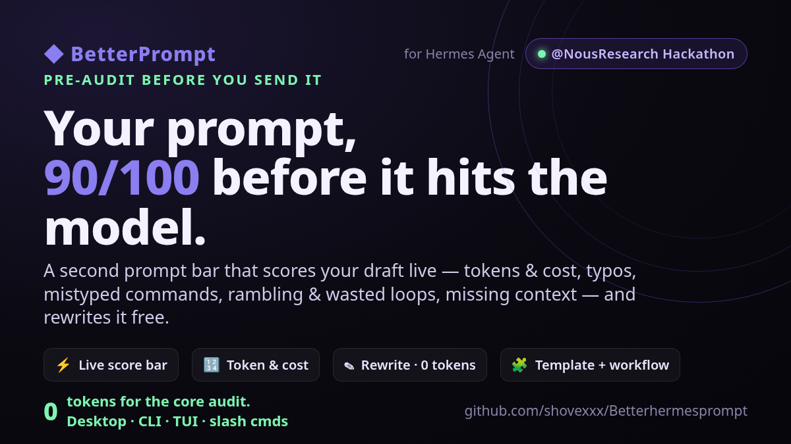

# BetterPrompt · pre-audit your prompt before you send it

**Version 1.0.0-beta** — first public beta.

**Stop paying for prompts that make the agent loop.** BetterPrompt is a Hermes
Agent plugin that audits what you're about to type *before* it goes to the
model — it scores your prompt, counts the tokens it will cost, catches typos
and mistyped commands, flags rambling / wasted-loop wording, checks for the
missing context that causes rework, and can rewrite the draft for free. One
bad prompt cleaned up saves more tokens than hours of tweaking responses.

Built for the **Hermes Agent Plugin Hackathon**.

## Media



Demo videos live in `assets/` of the repo (AI polish, CLI, and a short cartoon) — build or copy them locally if you need them.

## The problem it solves

The most expensive input a model ever reads is your prompt — every wasted
token is paid on *every* message in the conversation. And vague / contradictory
/ rambling prompts cause the agent to loop: ask a clarifying question, act on
the wrong thing, retry. That second cost is bigger than the first.

BetterPrompt attacks both **at the source, before the key is pressed:**

| Surface | What you get |
|---|---|
| **Hermes Desktop** | A second prompt bar right under the composer. Scores your draft live as you type — tokens, typos, filler, ambiguity, contradictions — with **✍️ Offline · 0 tokens** (spell-check + preconfigured templates, fully local), **✨ AI polish** and **🤖 AI generate** (on whichever model you've selected), **🎯 Fine-tune** (interviews you about the project first), a **force** mode that blocks sending until you've reviewed an edit, suggestion **popups with Edit/Send**, hover labels, and an auto-correct middleware for typos and mistyped slash commands. |
| **CLI** | `python cli.py "your prompt"` or `hermes prompt-audit "…"` — a colored report, `--rewrite`, `--json`, `--file`, `--models`. |
| **Slash / in-chat** | `/bhp-audit <prompt>` (local, free) and `/bhp-rewrite <prompt>` (AI polish on your active model). |
| **Tools for the agent** | `audit_prompt`, `audit_prompt_file`, `improve_prompt` — plus a bundled **skill** so Hermes audits a request before starting a long job. |
| **TUI** | `/auditprompt <prompt>` widget docked in the Ink TUI. |

## What it audits (deterministic, offline, **zero tokens**)

The core engine is pure Python/JS heuristics that run entirely on your machine.

- **Token & cost estimate** — approximate input tokens + estimated $ against a
  small model-pricing table (`--models` to list it).
- **Spelling & command correction** — a curated mutual-misspellings table plus
  edit-distance matching against the known Hermes slash-command and shell
  vocabulary, so `teh` → *the* and a mistyped `/memroy` → `/memory`.
- **Wasted looping & rambling** — filler/hedge phrases, repeated `please`,
  run-on sentences, low information-density, repeated imperative verbs,
  and **contradictory asks** (`delete` + `keep it`).
- **Clarity / missing context** — flags prompts with no input/location, no
  expected output format, no constraints, no error handling, or vague stakes.
- **Prompt templates + workflow** — classifies into 6 templates (Code, Debug,
  Research, Plan, Writing, Review) and gives a workflow tip per prompt.
- **Local rebuild** — a deterministic, free rewrite: fixes high-confidence
  typos, strips filler, collapses repeats, frames it with the best template.

## The AI polish layer (optional, additive)

If you want a proper LLM rewrite, `/bhp-rewrite` (or `improve_prompt`) calls
`ctx.llm.complete_structured()` on **your active model with host-owned
credentials** — it returns a tightened prompt plus the clarifying questions to
answer first. It degrades to the local rewrite when the model is unavailable.
This is the only part that spends tokens, and it's opt-in only.

## Install

```bash
# from the Hermes plugin catalog (once listed) or directly from GitHub:
hermes plugins install shovexxx/Betterhermesprompt
hermes plugins enable better-prompt

# Desktop: Capabilities → Plugins → enable BetterPrompt, then ⌘K → Reload desktop plugins.
# TUI widget (optional):
cp tui/auditprompt.mjs ~/.hermes/tui-widgets/ && /widgets-reload   # then /auditprompt "…"
```

Manual / piped install: `curl -fsSL https://raw.githubusercontent.com/shovexxx/Betterhermesprompt/main/install.sh | bash`

## Try it in 10 seconds (no install)

```bash
cd Betterhermesprompt
python3 -m cli 'hey basically i just want you to fix teh website please please, delete the old stuff but keep it, make it better and stuff'
```

Prints a `40/100` report with the typos, filler, contradiction and missing
context — then:

```bash
python3 -m cli --rewrite 'hey basically i just want you to fix teh website please please'
```

shows the cleaned draft.

```bash
python3 tests/test_engine.py   # 11/11 unit tests
```

## Repository layout

```
plugin.yaml               # Hermes plugin manifest (catalog admission)
__init__.py               # agent surface: slash cmds, 3 tools, bundled skill, CLI cmd
engine.py                 # the deterministic audit core (stdlib-only)
cli.py                    # standalone CLI (no Hermes needed)
skills/prompt-audit/      # bundled skill: pre-audit before long jobs
dashboard/                # plugin backend: /audit + /rewrite (ctx.rest) for the Desktop half
desktop/plugin.js         # the second prompt bar + toggle + middleware + palette cmds
tui/auditprompt.mjs       # TUI widget
tests/test_engine.py      # unit tests
install.sh                # installer (clone or piped)
plugin-catalog/           # the catalog submission entry (PR)
```

## How it fits Hermes' plugin rules

- Built entirely on **public seams**: `COMPOSER_AREAS`, `host.composer`
  (read/rewrite/send the live draft — the same path the maintained
  prompt-enhancer plugin migrated to), `PALETTE_AREA`, `STATUSBAR_AREAS`,
  `ctx.llm`, `ctx.register_tool/command/skill/cli_command`. No DOM reach-in,
  no core override — `hermes plugins validate` passes the `security scan`,
  `desktop surface` and `no core override` gates.
- The **only** network/LLM cost is the opt-in AI polish, which uses
  `ctx.llm` with host-owned credentials. No telemetry, no third-party calls.

## License

MIT — see `LICENSE`.
